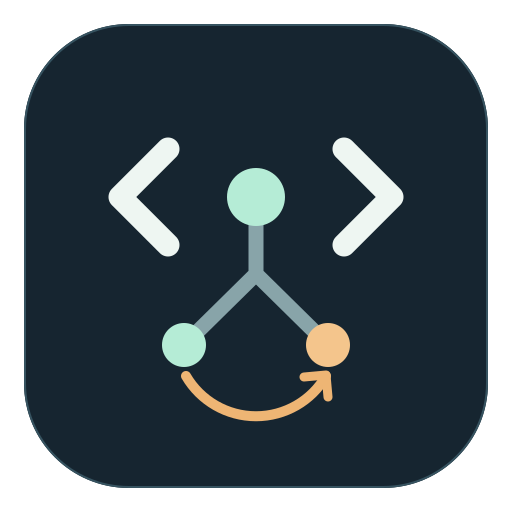

<p align="center">
  
</p>
<h1 align="center">Claude Code Analysis Agents</h1>
<p align="center"><strong>Trace business rules back to source code.</strong><br>A two-subagent workflow for Claude Code with an independent review step and a single HTML report.</p>
<p align="center">
  
  
  
</p>
<p align="center"><strong>English</strong> · <a href="README.zh-CN.md">简体中文</a></p>
<p align="center">
  <a href="#quick-start"><strong>Quick start</strong></a> ·
  <a href="docs/新方案-双Agent代码反推分析.md">Workflow design (Chinese)</a> ·
  <a href="docs/新方案-Agent提示词.md">Agent prompts (Chinese)</a> ·
  <a href="https://github.com/ProvenceJake/claude-code-analysis-agents/issues">Report an issue</a>
</p>

---

This prompt toolkit turns a codebase into a business-readable analysis with links back to files and symbols. It compares frontend behavior with backend enforcement, then translates verified rules into JavaScript functions with inputs, outputs, and test examples.

## How the agents work

| Main session | Research agent | Review agent |
| --- | --- | --- |
| Sets scope, delegates work, and routes findings back for revision. | Traces UI, API, data models, and jobs. Drafts the report and JavaScript rules. | Opens cited source files independently, checks the rules, and returns a pass or a list of changes. |

The main session sends each revision back for review. Unresolved questions prevent approval. If required material is unavailable, the session identifies what evidence is needed and marks the run as incomplete.

## Quick start

1. Install and sign in to [Claude Code](https://code.claude.com/docs/en/quickstart).
2. Clone this repository and launch Claude Code in the project you want to analyze. Replace the example path.

   ```sh
   git clone https://github.com/ProvenceJake/claude-code-analysis-agents.git "/path/to/claude-code-analysis-agents"
   cd "/path/to/project"
   claude --add-dir "/path/to/claude-code-analysis-agents"
   ```

3. Paste the instruction below with the path to your cloned copy.

   ```text
   Read /path/to/claude-code-analysis-agents/docs/新方案-Agent提示词.md.
   Treat the current repository as the source. Use the Agent tool to delegate
   to exactly two separate subagents with the research and review roles in
   sections 2 and 3. Follow the startup instructions in section 5.
   Write the report in English. Revise and request review until it passes.
   Deliver only analysis-report.html in the current repository.
   ```

4. Open `analysis-report.html` after the reviewer approves it.

## Inside the report

| Section | What it shows |
| --- | --- |
| System overview | Feature map, entities and relationships, and key business flows |
| Runtime and access | External integrations, background jobs, and permissions matrix |
| Rules and evidence | Frontend and backend sources, JavaScript rule functions, test examples, and a source index |
| Review | Issues raised, revisions made, and the final decision |

## Scope

This repository contains the Claude Code workflow specification and prompts. Claude Code runs the analysis in your local session and applies its configured tool permissions. The HTML includes its styles and can be read offline. See the [Claude Code subagent documentation](https://code.claude.com/docs/en/sub-agents) for setup and permissions.
