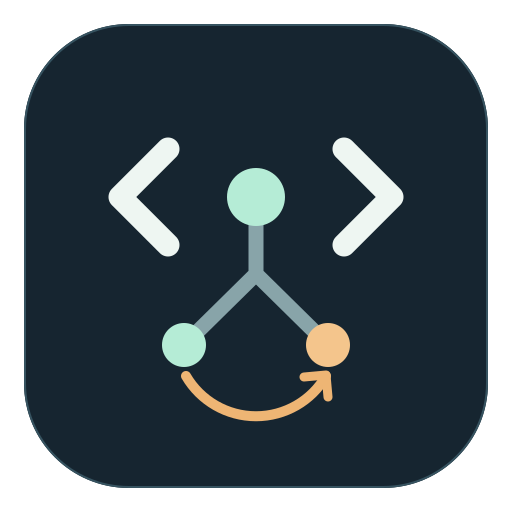

<p align="center">
  
</p>
<h1 align="center">Claude Code Analysis Agents</h1>
<p align="center"><strong>从代码还原业务规则，并保留可核查的依据。</strong><br>基于 Claude Code 的双子 Agent 分析流程，独立审查后交付一个 HTML 报告。</p>
<p align="center">
  
  
  
</p>
<p align="center"><a href="README.md">English</a> · <strong>简体中文</strong></p>
<p align="center">
  <a href="#快速开始"><strong>快速开始</strong></a> ·
  <a href="docs/新方案-双Agent代码反推分析.md">方案说明</a> ·
  <a href="docs/新方案-Agent提示词.md">Agent 提示词</a> ·
  <a href="https://github.com/ProvenceJake/claude-code-analysis-agents/issues">反馈问题</a>
</p>

---

这套提示词帮助团队从已有项目中梳理系统能力、业务流程和规则，并把每条关键结论关联到源文件和代码符号。分析时交叉核查前端行为与后端校验，把有据可查的规则转成带输入、输出和测试样例的 JavaScript 函数。

## 智能体分工

| 总 Agent | 代码调研与产出 Agent | 审查与打回 Agent |
| --- | --- | --- |
| 确定范围、调度两个子 Agent，并跟踪每轮修正。 | 追查页面、接口、数据模型与后台任务，编写报告和规则代码。 | 独立核查源代码与规则，给出通过结论或明确的修改清单。 |

每次修改后都要复审。有未解决的疑点就继续查证。如果缺少必需的资料或访问权限，总 Agent 会说明缺什么，并标记本次分析未完成。

## 快速开始

1. 安装并登录 [Claude Code](https://code.claude.com/docs/en/quickstart)。
2. 克隆本仓库，在要分析的项目目录中启动 Claude Code。将示例路径换成真实路径。

   ```sh
   git clone https://github.com/ProvenceJake/claude-code-analysis-agents.git "/本仓库的绝对路径"
   cd "/你的项目路径"
   claude --add-dir "/本仓库的绝对路径"
   ```

3. 把下面这段发给 Claude Code，并填入提示词的实际路径。

   ```text
   阅读 /本仓库的绝对路径/docs/新方案-Agent提示词.md。
   以当前仓库为分析对象。用 Agent 工具分别调用两个子 Agent，
   按第 2、3 节分工，以第 5 节启动提示词为准。
   每次修正都交给审查 Agent 复审，直到通过。
   最终只在当前仓库输出一个 analysis-report.html。
   ```

4. 审查通过后，打开项目中的 `analysis-report.html`。

## 报告内容

| 内容 | 覆盖范围 |
| --- | --- |
| 系统全貌 | 功能地图、实体关系、重点功能的端到端业务流程 |
| 运行与权限 | 外部系统、后台任务、权限矩阵 |
| 业务规则与证据 | 前后端证据、JavaScript 规则函数、测试样例、代码索引 |
| 审查记录 | 打回问题、修正记录和最终审查结论 |

## 使用范围

仓库提供 Claude Code 工作流方案和提示词。分析在本地 Claude Code 会话中执行，遵循该会话的工具权限。报告样式和内容内嵌，可离线打开。子代理和权限设置见 [Claude Code 官方文档](https://code.claude.com/docs/en/sub-agents)。
